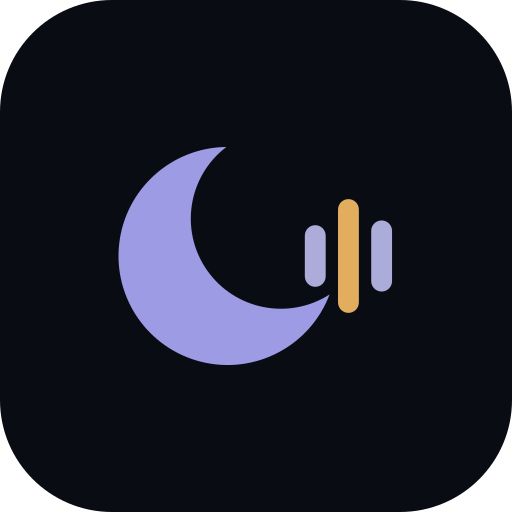
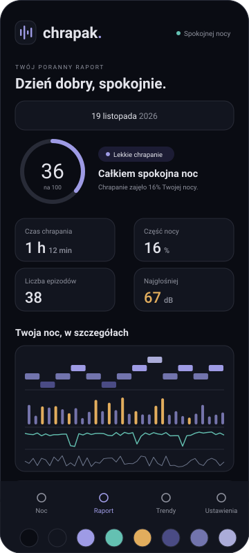
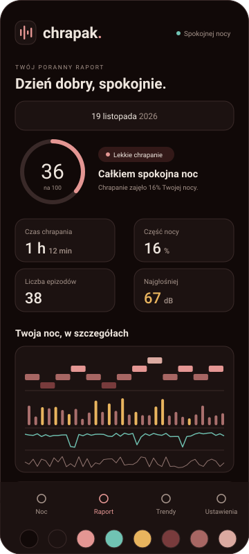
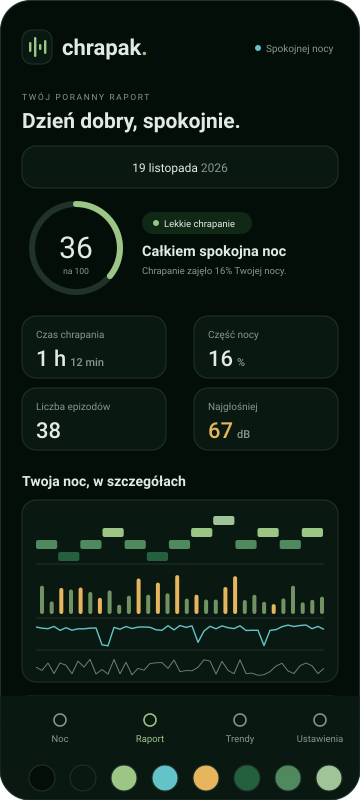
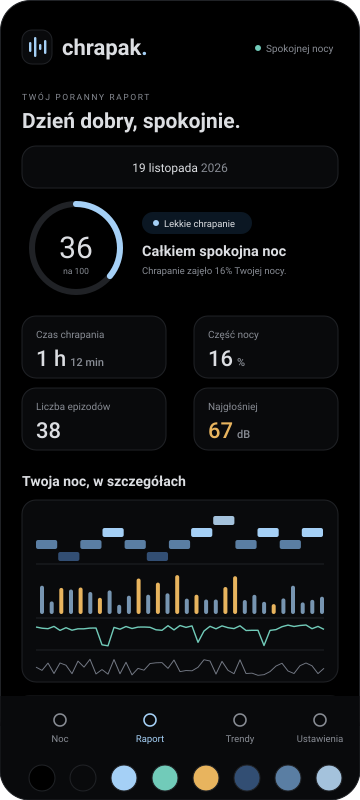
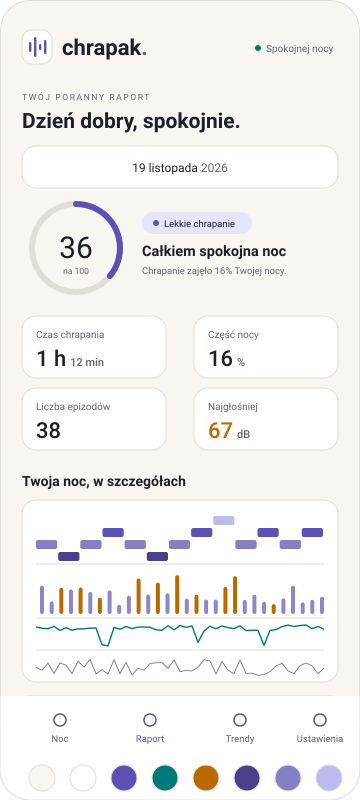

<p align="center"></p>

# Chrapak

Aplikacja, która **nagrywa i analizuje Twoje chrapanie podczas snu** oraz zestawia je z danymi z pierścienia i opaski: fazami snu, saturacją (SpO₂) i tętnem. Nagrania zostają na telefonie.

Projekt ma dwie części:

| Część | Gdzie | Stan |
|---|---|---|
| **Makieta interaktywna** (React, dane testowe) | `src/` | gotowa, z pięcioma motywami wyglądu |
| **Aplikacja na Androida** (Kotlin, Jetpack Compose) | `android/` | działa na telefonie: automatyczny nasłuch (noc i drzemki), detekcja dwustopniowa, raport z Health Connect, analiza nagrań, motywy z Material You. Czeka na test pełnej nocy |

Docelowy sprzęt: telefon z Androidem (mikrofon), **RingConn Gen 2 Air** i **Xiaomi Smart Band 10** jako źródła danych o śnie przez Health Connect.

## Motywy wyglądu

Motyw wybierasz w **Ustawienia → Wygląd**, a wybór zapamiętuje się w przeglądarce. Motywy zmieniają tylko kolory i zaokrąglenia, układ ekranów jest wszędzie ten sam.

<table>
  <tr>
    <th align="center">Północ</th>
    <th align="center">Żar</th>
    <th align="center">Las</th>
    <th align="center">Czerń OLED</th>
    <th align="center">Dzień</th>
  </tr>
  <tr>
    <td></td>
    <td></td>
    <td></td>
    <td></td>
    <td></td>
  </tr>
  <tr>
    <td valign="top">Granat i fiolet. Domyślny.</td>
    <td valign="top">Ciepły brąz i róż, mało niebieskiego światła. Do sypialni.</td>
    <td valign="top">Głęboka zieleń i szałwia.</td>
    <td valign="top">Czysta czerń. Oszczędza baterię na ekranie OLED.</td>
    <td valign="top">Jasny, papierowy. Do porannego raportu.</td>
  </tr>
</table>

Podglądy powstają z tokenów w [`src/styles.css`](src/styles.css), więc zawsze odpowiadają prawdziwej palecie. Po zmianie kolorów odśwież je poleceniem:

```sh
node scripts/generate-theme-svgs.mjs
```

## Ekrany makiety

- **Noc**: start i stop nasłuchu, harmonogram, lista kontrolna przed snem.
- **Raport**: wynik chrapania, statystyki nocy i wspólna oś czasu (fazy snu, chrapanie, SpO₂, tętno) oraz wnioski.
- **Zdarzenia**: klipy z chrapaniem z odtwarzaczem, filtrami i oznaczaniem fałszywych trafień.
- **Trendy**: 7, 30 i 90 nocy oraz wpływ czynników (alkohol, późny posiłek, pozycja snu).
- **Ustawienia**: motyw, źródła danych, czułość wykrywania, pamięć, zasilanie (Xiaomi/HyperOS) i prywatność.

Makieta używa 30 nocy danych testowych z [`src/data/mock.ts`](src/data/mock.ts). Typy w tym pliku (`SnoreEvent`, `SleepStage`, `VitalSample`, `Night`) są wzorem dla modelu danych aplikacji na Androida.

## Uruchomienie makiety

Potrzebujesz [Bun](https://bun.sh) (albo Node.js 20+).

```sh
bun install
bun run dev      # serwer deweloperski
bun run test     # testy
bun run build    # build produkcyjny
```

## Jak ma działać detekcja

Priorytetem jest minimalne zużycie energii, bo telefon nagrywa całą noc:

1. **Tania bramka** działa cały czas: energia w paśmie 100–2000 Hz na krótkich ramkach (16 kHz, mono) z adaptacyjnym progiem względem poziomu ciszy w pokoju. Nie używa żadnego modelu.
2. **Klasyfikator** (YAMNet, klasa „Snoring") budzi się tylko wtedy, gdy bramka przekroczy próg.
3. Bufor kołowy w pamięci przechowuje kilka sekund dźwięku przed zdarzeniem. Na dysk trafiają wyłącznie klipy ze zdarzeniami, a nie cała noc.

Szczegóły i stan prac: [`android/`](android/).

## Prywatność

Dźwięk jest analizowany na urządzeniu i nie jest nigdzie wysyłany. Dane o śnie, saturacji i tętnie są odczytywane z Health Connect za zgodą użytkownika.

## Technologie

- Makieta: React 19, TanStack Start, Tailwind CSS 4, Recharts, Vite.
- Android: Kotlin, Jetpack Compose, Room, foreground service z typem `microphone`, Health Connect.

Makieta została zbudowana w [Lovable](https://lovable.dev). Zmiany wypchnięte na połączoną gałąź synchronizują się z edytorem Lovable, dlatego nie przepisuj opublikowanej historii gita.
