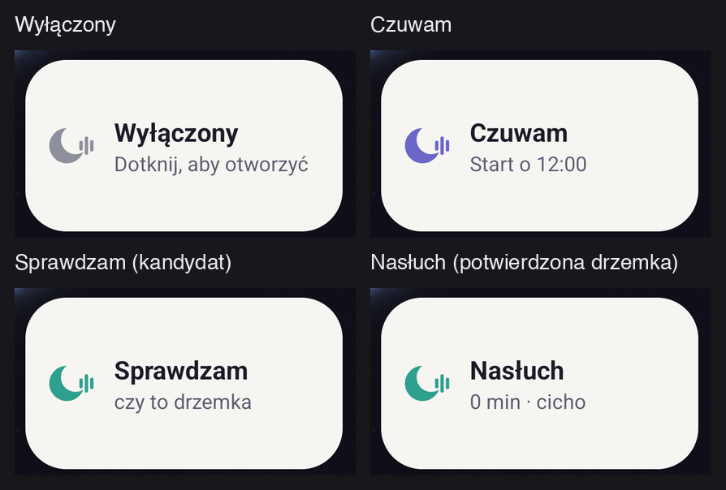

# Chrapak na Androida

Aplikacja nagrywa chrapanie przez całą noc w usłudze pierwszoplanowej i zapisuje tylko krótkie klipy ze zdarzeniami. Na razie to szkielet z działającym serwisem nagrywającym i detekcją. Ekrany z makiety (`../src`) zostaną przepisane na Compose później.

## Budowanie i testy

Potrzebujesz JDK 17+ i Android SDK (platforma 37). Utwórz `local.properties` z linią `sdk.dir=<ścieżka do SDK>`.

```sh
./gradlew :app:testDebugUnitTest   # testy detekcji na sztucznym sygnale
./gradlew :app:assembleDebug       # app/build/outputs/apk/debug/app-debug.apk
```

## Podpis

Każdy build (release i debug) podpisuje jeden klucz Chrapaka. Android nie zainstaluje aktualizacji podpisanej innym kluczem, a każdy komputer ma własny klucz debug, więc wcześniej każda zmiana komputera oznaczała odinstalowanie aplikacji i utratę nagrań (tak było z 1.5.0 i 1.7.0).

- Klucz **nie jest w repozytorium**. Gradle szuka pliku `~/.chrapak-signing/keystore.properties` (albo ścieżki ze zmiennej `CHRAPAK_SIGNING`):

  ```properties
  storeFile=/ścieżka/do/chrapak-release.jks
  storePassword=…
  keyAlias=chrapak
  keyPassword=…
  ```

- Na nowym komputerze skopiuj folder `~/.chrapak-signing/` z istniejącego (bezpiecznym kanałem, nie przez git ani czat). **Zrób jego kopię zapasową**, np. w menedżerze haseł: bez niego nie da się wydać aktualizacji, która zainstaluje się na istniejącej aplikacji.
- Bez klucza wersja debug podpisuje się kluczem debug komputera, a `assembleRelease` kończy się błędem, zamiast po cichu podpisać APK czymś innym.
- Release buduj skryptem, który sprawdza odcisk certyfikatu z [`signing/release-cert.sha256`](signing/release-cert.sha256) i obecność modelu:

  ```sh
  ./scripts/build-release.sh   # dist/chrapak-<wersja>.apk
  ```

## Jak działa detekcja

Priorytetem jest mało energii, bo telefon pracuje całą noc.

| Etap | Plik | Kiedy działa |
|---|---|---|
| Bramka energii | [`EnergyGate.kt`](app/src/main/kotlin/app/chrapak/detection/EnergyGate.kt) | Każda ramka 32 ms. Filtr pasmowy 100–2000 Hz, adaptacyjny próg względem ciszy w pokoju (minimum zależne od czułości: −68 / −70 / −78 dBFS, kalibracja może je obniżyć, najniżej do −80 dBFS). Kilka mnożeń na próbkę, bez modelu. Opcjonalny test udziału niskich tonów jest domyślnie wyłączony, bo na telefonie nie odróżniał chrapania od szumu. |
| Segmentacja | [`SnoreSegmenter.kt`](app/src/main/kotlin/app/chrapak/detection/SnoreSegmenter.kt) | Łączy aktywność rozdzieloną przerwami do 6 s w jeden epizod (cykl oddechu to 3–5 s). Odrzuca epizody krótsze niż 3 s oraz rzadkie, w których aktywnych ramek jest łącznie mniej niż 1,5 s. Po drodze zapisuje początki osobnych serii (pauza ponad 0,4 s), z których liczy się rytm. **Epizod dłuższy niż 60 s jest cięty na kawałki**: w cichej sypialni przy czułym progu bramka potrafiła być otwarta pół godziny (oddech, szum, kilka chrapnięć). Cały taki epizod liczył się jako chrapanie, a jego nagranie miało tylko pierwszą minutę. Teraz każdy kawałek ma własną ocenę i własne nagranie. |
| Rytm | [`BurstRhythm.kt`](app/src/main/kotlin/app/chrapak/detection/BurstRhythm.kt) | Mediana odstępu między seriami (chrapanie: 2–8 s) i regularność (1 − odchylenie/mediana). Kaszel, drzwi i skrzypienie łóżka wypadają nieregularnie, więc dostają 0. Liczone raz na epizod, nie na ramkę. |
| Klasyfikator | [`YamnetClassifier.kt`](app/src/main/kotlin/app/chrapak/detection/YamnetClassifier.kt) (interfejs w [`DetectionPipeline.kt`](app/src/main/kotlin/app/chrapak/detection/DetectionPipeline.kt)) | YAMNet przez LiteRT, klasa „Snoring”. Tylko gdy epizod jest otwarty i ramka jest aktywna, co ok. 1 s. Test pilnuje, że w ciszy nie wywołuje się ani razu. |
| Ocena epizodu | [`DetectionQuality.kt`](app/src/main/kotlin/app/chrapak/detection/DetectionQuality.kt) (`EpisodeJudge`) | Na końcu epizodu, z najlepszych ocen YAMNet (chrapanie oraz dźwięki czuwania: mowa, telewizja, muzyka, kroki) i z rytmu. **Zapisany i liczony:** chrapanie ≥ 0,3, albo słabe chrapanie (≥ 0,1) w rytmie oddechu (≥ 0,6). **Zapisany jako niepewny:** chrapanie 0,1–0,3 bez rytmu. **Odrzucony bez zapisu dźwięku:** chrapanie poniżej 0,1 (szelest, auto, kaszel; sam rytm nie ratuje, bo kapiący kran też jest regularny) albo dźwięk czuwania ≥ 0,5 silniejszy niż chrapanie. |
| Limit niepewnych | [`DetectionQuality.kt`](app/src/main/kotlin/app/chrapak/detection/DetectionQuality.kt) (`UncertainBudget`) | Najwyżej 10 niepewnych nagrań na noc, te z najwyższą oceną; słabsze są usuwane na bieżąco. Wcześniej zapisywał się każdy dźwięk z bramki, co dawało 50–60 niepewnych nagrań na noc. Niepewne nie liczą się do wyniku i znikają po 7 dniach, chyba że je zachowasz. |
| Bufor kołowy | [`PreRollBuffer.kt`](app/src/main/kotlin/app/chrapak/detection/PreRollBuffer.kt) | 5 s dźwięku przed zdarzeniem w pamięci. Na dysk trafiają tylko klipy ze zdarzeniami. |

Serwis ([`ListeningService.kt`](app/src/main/kotlin/app/chrapak/service/ListeningService.kt)) czyta mikrofon po 0,5 s, wybiera źródło `UNPROCESSED` (bez automatycznej regulacji głośności), jeśli telefon je wspiera, a zapis klipów i bazy robi na osobnej korutynie, żeby dysk nie opóźniał odczytu.

## Model YAMNet

Plik modelu (4 MB, Apache 2.0) nie jest w repozytorium. Pobierz go skryptem, który weryfikuje sumę SHA-256:

```sh
./scripts/fetch-yamnet.sh   # zapisuje app/src/main/assets/yamnet.tflite
```

**Build bez modelu się nie uda** (`merge*Assets` kończy się komunikatem, żeby uruchomić skrypt). Wcześniej APK bez modelu budował się bez ostrzeżenia, a aplikacja po cichu działała na samej bramce i nie odróżniała chrapania od mowy. Tak było z wersją zainstalowaną na telefonie 23.11. Indeks klasy „Snoring” jest czytany z etykiet zapisanych w pliku modelu.

### Pomiar na telefonie

Test na Poco z mikrofonem `UNPROCESSED` (poziomy w dBFS):

| Dźwięk | Maks. „Snoring” |
|---|---|
| Chrapanie (naśladowane) | 0,74 |
| Cisza, mowa, klaśnięcia | ≤ 0,02 |
| Chrapanie (naśladowane, test 24.11) | 0,96 |
| Mowa (ten sam test) | 0,00 |

Pokój w ciszy ma ok. −85 dB, naśladowane chrapanie średnio ok. −64 dB. Próg `minConfidence` wynosi 0,3 i wymaga dostrojenia na prawdziwych nocach.

## Dane

Room ([`Entities.kt`](app/src/main/kotlin/app/chrapak/data/Entities.kt)) odpowiada typom `Night` i `SnoreEvent` z makiety. Schemat jest eksportowany do `app/schemas/`. Klipy to pliki WAV w `files/clips/<noc>/`.

## Ikona


Półksiężyc (sen) i trzy zaokrąglone słupki (dźwięk chrapania), z których środkowy jest bursztynowy jak najgłośniejsze epizody w raporcie. Jest to ikona adaptacyjna z warstwą monochromatyczną, więc na Androidzie 13+ przyjmuje kolory tapety, oraz osobny, jednokolorowy znaczek do powiadomień i kafelka. Kształty są zapisane raz, w [`docs/icon/icon.svg`](../docs/icon/icon.svg) i w wektorach `res/drawable/ic_launcher_*.xml`.

## Ekrany

Compose, z motywem wybieranym w Ustawieniach.

- **Noc.** Duży oddychający przycisk do włączania i zatrzymywania nasłuchu, czas trwania i licznik epizodów, spokojny wskaźnik poziomu dźwięku w pokoju, karta czuwania z oknem nocnym oraz lista kontrolna przed nocą (mikrofon, powiadomienia, wyjątek od oszczędzania baterii, ładowarka).
- **Raport.** Wynik, statystyki, oś czasu ze snem, chrapaniem, SpO₂ i tętnem, wnioski i arkusz szczegółów epizodu.
- **Nagrania.** Osobna karta: wszystkie noce i drzemki z liczbą epizodów i miejscem na dysku. Po dotknięciu nocy lista klipów z filtrami (Chrapanie, Niepewne, Zachowane, Fałszywe), odtwarzaniem, analizą, „Zachowaj”, „Fałszywy” i menu „Więcej”: udostępnij (dowolnej aplikacji), zapisz w plikach, usuń. To samo jest dostępne z Raportu.
- **Analiza nagrania.** Liczona na telefonie: przebieg fali ze znacznikami chrapnięć, rytm (chrapnięć na minutę), najdłuższa przerwa, udział energii w pasmach 100–2000 Hz oraz to, co słyszy YAMNet sekunda po sekundzie i jakie dźwięki dominują. To obserwacje z jednego nagrania, nie diagnoza.
- **Ustawienia.** Czuwanie i okno nocne, **czułość wykrywania** (Niska, Średnia, Wysoka) z **kalibracją pokoju** (10 s ciszy, próg może tylko spaść), wyjątek od baterii, motyw, połączenie z Health Connect i podgląd ostatnich 24 h z pierścienia.

Wynik chrapania to udział chrapania w nocy: 30% nocy daje 100. Nagrania krótsze niż 30 minut (próby, krótkie drzemki, noc, która dopiero się zaczęła) nie dostają wyniku, bo udział z kilku minut nic nie mówi. Wniosek o REM i o SpO₂ pojawia się tylko wtedy, gdy są dane ze snu i saturacji.

## Motywy

Ustawienia → **Wygląd**: Systemowy (jasny w dzień, ciemny w nocy), Jasny, Ciemny (domyślny), **Material You** (kolory z tapety, Android 12+), a do tego trzy motywy z makiety: Żar, Las i Czerń OLED. Jedna paleta ([`Palette.kt`](app/src/main/kotlin/app/chrapak/ui/theme/Palette.kt)) napędza cały interfejs, także wykresy na Canvasie, a kolory danych (SpO₂, głośne chrapanie) zostają stałe w Material You, żeby wykres znaczył to samo przy każdej tapecie. Zrzuty ekranów i motywów z telefonu są w [README repozytorium](../README.md#aplikacja-na-androidzie-zrzuty-ekranu).

## Powiadomienia

Wszystkie są lokalne. Przełączniki są w Ustawieniach → **Powiadomienia**; każdy kanał można też wyciszyć w systemowych ustawieniach Androida.

- **Live Update (Android 16+).** Nasłuch w toku (przy drzemce dopiero po jej potwierdzeniu) jest promowanym powiadomieniem z licznikiem czasu, liczbą epizodów i paskiem postępu do końca okna lub drzemki (przy ręcznym nasłuchu pasek jest nieokreślony). System może pokazać je jako chip w pasku stanu. Sprawdzone na Androidzie 17: powiadomienie ma flagę `PROMOTED_ONGOING`. Na starszych wersjach to zwykłe trwałe powiadomienie z licznikiem.
- **Podsumowanie po nocy.** Ciche (bez dźwięku, bo okno często kończy się, gdy jeszcze śpisz). W tytule noc i wynik („Noc 23:10–07:00 · 34/100”), w treści czas chrapania, liczba epizodów, najdłuższy epizod z godziną, ocena słowna i porównanie z poprzednią nocą tego samego rodzaju („Lepiej niż poprzednio (45/100)”, różnica od 10 punktów). Akcje **„Raport”** i **„Posłuchaj”** (zakładka Nagrania). Drzemka mówi o „% drzemki” i jest porównywana tylko z drzemkami. Można je wyłączyć.
- **Tygodniowe podsumowanie.** W niedzielę o 10:00: liczba nocy, średni wynik, porównanie z poprzednim tygodniem i najgorsza noc z dniem tygodnia („najgorsza noc: czwartek, 62/100”). Drzemki się nie liczą. Dotknięcie otwiera Raport. Działa też bez włączonego czuwania. Buduje je czysta funkcja ([`WeeklyDigest`](app/src/main/kotlin/app/chrapak/schedule/WeeklyDigest.kt)) pokryta testami; w Ustawieniach jest „Wyślij podsumowanie testowe”.
- **Przypomnienie o ładowarce.** Pół godziny przed startem okna (przy oknie 23:00 o 22:30, przy 12:00 o 11:30), tylko gdy czuwanie jest włączone, telefon **naprawdę** nie jest ładowany (stan baterii z systemu) i nic nie jest nagrywane: „Nasłuch zacznie się o 23:00”. Akcje: **„Włącz teraz”** i **„Nie dziś”**. Reguła ([`PrepReminderRule`](app/src/main/kotlin/app/chrapak/schedule/PrepReminder.kt)) jest czysta i testowana.
- **Alerty.** „Nasłuch nie wystartował”, gdy Android nie pozwolił włączyć mikrofonu w tle albo po restarcie telefonu.

Alarmy digestu i przypomnienia są przestawiane razem z oknem nocnym (przy zmianie ustawień, starcie telefonu, zmianie strefy), a po każdym odpaleniu — na następny dzień lub niedzielę. Prawdziwy push z serwera (FCM) wymagałby własnego backendu i nie jest potrzebny do niczego powyżej.

## Widżet

Mały widżet na ekran główny (1×1 lub 2×1, da się zmieniać rozmiar) pokazuje bieżący stan: **Nasłuch** (czas i liczba epizodów), **Czuwam** (z godziną startu), **Sprawdzam** (kandydat na drzemkę czeka na potwierdzenie), **Czuwanie przerwane** albo **Wyłączony**. Dotknięcie otwiera aplikację. Kolory podążają za jasnym i ciemnym trybem telefonu. W Ustawieniach jest jego podgląd i przycisk „Dodaj na ekran główny”.

Treść wylicza czysta funkcja ([`WidgetModel`](app/src/main/kotlin/app/chrapak/widget/WidgetModel.kt)) pokryta testami, a widżet odświeża się przy zmianie stanu usługi, co minutę podczas nasłuchu oraz przy starcie aplikacji i po restarcie telefonu. Nie budzi procesora poza tym. Sprawdzone na emulatorze, jeszcze nie na telefonie.



## Automatyczny nasłuch

Nasłuch startuje sam, bez otwierania aplikacji. Ustawienia → **Automatyczny nasłuch** włącza **czuwanie**: usługa żyje w tle z powiadomieniem „Czuwam”, ale nic nie nagrywa i nie zużywa energii (mikrofon wyłączony). Gdy zaczyna się okno (domyślnie 23:00–07:00), usługa sama włącza mikrofon, a po końcu okna kończy nasłuch i wraca do czuwania.

- **Dlaczego czuwanie, a nie samo uruchamianie z alarmu.** Android nie pozwala włączyć mikrofonu usłudze startowanej z tła. Usługa uruchomiona raz, gdy aplikacja jest widoczna, zachowuje ten dostęp i może później otworzyć mikrofon przy wygaszonym ekranie. Sprawdzone na telefonie (Android 17, HyperOS): nasłuch wystartował z alarmu przy ekranie wygaszonym i aplikacji w tle.
- **Drzemki.** Kafelek „Chrapak” w Szybkich ustawieniach włącza nasłuch jednym dotknięciem na 3 godziny albo do ponownego dotknięcia. Można też włączyć wykrywanie drzemek o dowolnej porze poza nocą (patrz niżej).
- **Pierścień nie może być wyzwalaczem na żywo.** RingConn zapisuje do Health Connect z opóźnieniem godzin (mediana: sen ok. 9,4 h, tętno ok. 4 h, SpO₂ ok. 6 h), więc Health Connect dowiaduje się o śnie dopiero po fakcie. Ustawienia pokazują ten pomiar dla każdej aplikacji.
- **Po restarcie telefonu lub aktualizacji** czuwanie wraca po otwarciu aplikacji. Android 15 i nowszy zabrania uruchamiania mikrofonu z odbiornika startu systemu, więc aplikacja przypomina powiadomieniem.
- **Gdy Android nie pozwoli** włączyć mikrofonu w tle, użytkownik dostaje powiadomienie „Nasłuch nie wystartował”, zamiast cichej porażki.


### Wykrywanie drzemek bez fałszywych alarmów

Drzemkę zgaduję z tego, co widzi telefon, więc to domysł, który trzeba chronić przed pomyłką. Kolejne zabezpieczenia:

Detektor działa **przez całą dobę poza oknem nocnym**, a o nietypowej porze wymaga więcej dowodów. Kolejne zabezpieczenia:

1. **Reguła czasu** ([`NapDetector`](app/src/main/kotlin/app/chrapak/schedule/NapDetector.kt)): czuwanie włączone, poza oknem nocnym, ekran wygaszony od 15 minut i brak istotnego ruchu (czujnik ruchu, który się nie budzi, dopóki telefon nie jest przenoszony).
2. **Druga opinia z czujników** przy samej decyzji. Wykluczają start: telefon zasłonięty (kieszeń, torba) albo **trzymany** (drobne drgania akcelerometru: ręka, kolana, kanapa). Poza tym potrzeba oznak: leży płasko, jest ciemno (nie liczy się, gdy telefon leży ekranem w dół, bo wtedy czujnik światła pokazuje zero w każdym pokoju), jest podłączony do ładowarki, cisza trwa dwa razy dłużej niż wymagane. W typowych godzinach drzemki (11:00–20:00) wystarczą **dwie**, o innej porze potrzeba **trzech**. Nieznany czujnik nie wnosi nic i niczego nie wyklucza.
3. **Potwierdzenie dźwiękiem** ([`NapJudge`](app/src/main/kotlin/app/chrapak/schedule/NapJudge.kt)): to, że telefon leży i milczy, jeszcze nie jest drzemką, więc start jest tylko *kandydatem*. YAMNet co 15 s słucha pokoju przez najwyżej 20 minut. Dwa okna z mową, telewizją, muzyką, pisaniem albo krokami **odwołują** kandydata. Chrapanie (≥ 0,3 i więcej niż dźwięki czuwania) albo spokojny oddech w trzech oknach **potwierdzają** drzemkę. Sama cisza nie rozstrzyga, a po 20 minutach bez śladu śpiącego kandydat jest porzucany.
4. **Aktywność na żywo dopiero po potwierdzeniu.** Dopóki trwa sprawdzanie, powiadomienie jest zwykłe, bez chipa w pasku stanu, a widżet pokazuje „Sprawdzam”. Fałszywy kandydat nigdy nie wygląda jak drzemka.
5. **Sprzątanie**: drzemka bez żadnego chrapania jest usuwana, więc raport nie zapełnia się pustymi wpisami.
6. **Koniec** drzemki to pierwsze włączenie ekranu albo limit 3 godzin, a po zakończeniu detektor nie startuje od razu ponownie.

Logika (reguły czasu, oznaki, weto, sędzia) jest pokryta testami jednostkowymi. Na telefonie potwierdzono wcześniejszą wersję: odczyt czujników i decyzję (nie zasłonięty, leży płasko, 37 lx, ładowarka), próbę dźwiękową co 15 s, zakończenie drzemki i usunięcie pustej drzemki z bazy. Nowe kryteria (weto „trzymany”, ciemność tylko ekranem w górę, trzy oznaki o nietypowej porze, dwustopniowe potwierdzenie) sprawdzono na emulatorze i testami jednostkowymi. **Nie potwierdzono jeszcze na telefonie całej ścieżki od wygaszenia ekranu przez alarm do startu**: wcześniejsze próby przerwało włączenie ekranu, więc to wymaga prawdziwej drzemki.

### HyperOS wstrzymuje bezczynne aplikacje

Po ok. 2,5 minuty bez dźwięku HyperOS oznacza aplikację jako bezczynną (`background->idle`) i potrafi opóźnić, przyspieszyć lub zgubić jej alarmy. Zaobserwowano to bez wyjątku od oszczędzania baterii: alarm startu przychodził co do milisekundy, gdy aplikacja była świeżo aktywna, ale alarm końca dotarł 2 min 23 s za wcześnie, a w innej próbie alarm końca i „pies stróżujący” nie dotarły wcale. Dlatego:

- koniec nasłuchu sprawdza **zegar**, a nie tylko alarm: pętla odczytu sama kończy nasłuch na końcu okna, a spóźniony alarm startu jest ignorowany, gdy okno nie trwa;
- co 5 minut działa lekki alarm kontrolny, który włączy nasłuch, jeśli okno już trwa, a alarm startu przepadł;
- **w aplikacji jest karta „Oszczędzanie baterii”** z prośbą o wyjątek. Bez niego automat nie jest wiarygodny. Na Xiaomi włącz też Autostart i ustaw baterię na „Bez ograniczeń”.

Test z wyjątkiem od oszczędzania baterii jeszcze nie był zrobiony.

## Health Connect

Odczyt (bez zapisu) snu, tętna i SpO₂. Sprawdzone na telefonie: RingConn zapisuje do Health Connect sesje snu z fazami, tętno i SpO₂, a opaska Xiaomi nie zapisuje nic. Ustawienia pokazują dla każdej aplikacji liczbę rekordów z ostatnich 3 dni.

## Zużycie energii

Pomiar czasu CPU aplikacji przy wygaszonym ekranie (telefon na ładowarce, nasłuch z klasyfikatorem):

| Wersja | CPU (jeden rdzeń) |
|---|---|
| debug | ok. 2,9% |
| `benchmark` (bez flagi debugowania) | ok. 1,6% w cichym pokoju |

Klasyfikator wywołał się tylko kilka razy w ciągu kilku minut, więc koszt to głównie odczyt mikrofonu i bramka. Zmiana odczytu mikrofonu z 0,5 s na 1 s dała niejednoznaczny wynik (hałas w pokoju zmieniał obciążenie), więc zostaje 0,5 s. `./gradlew :app:assembleBenchmark` buduje wariant do takich pomiarów, podpisany kluczem debug.

## Czego jeszcze nie ma

- **Strojenie na prawdziwych nocach.** Progi bramki i klasyfikatora opierają się na krótkich testach z naśladowanym chrapaniem (kilkuminutowy nasłuch w pokoju dał zero fałszywych zdarzeń).
- **Pełna noc na telefonie i pomiar baterii.** Nie sprawdzono zachowania HyperOS przy ograniczeniach baterii i autostarcie. Aplikacja nie jest na liście wyjątków oszczędzania baterii.
- **Przeliczenie dBFS na dB** pokazywane w makiecie. Wymaga kalibracji mikrofonu danego telefonu.
- **Analiza AI na własnym serwerze** (do omówienia, patrz niżej w opisie projektu).
- **Trendy, tagi, przełącznik motywów** i pełne ustawienia detekcji z makiety.
